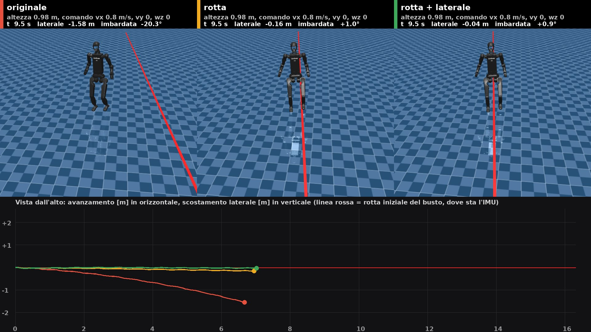
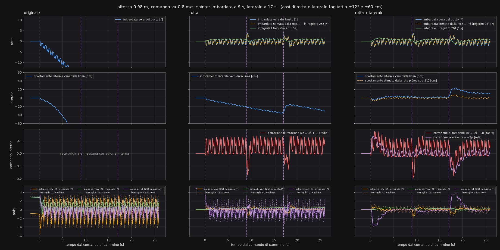

# Example 1 — Unitree H1_2: heading hold written into the weights

**Source policy.** The walk + squat policy of the Unitree H1_2 humanoid from
[gaetanotorella/H1_2_Squat_Locomotion_RL](https://github.com/gaetanotorella/H1_2_Squat_Locomotion_RL)
(`policies/h1_2_squat/2026-09-13_21-27-39`): an MLP 465 → 512 → 256 → 128 → 27 with ELU, trained
with PPO in Isaac Lab, deployed on the real robot by a C++ controller.

**Defect.** With a walking command and the turn stick at zero the robot does not walk straight: it
turns by 2.84 °/s on average and after 30 s it has rotated by 82°. The observations contain no
velocity and no heading, and the network has no memory, so nothing inside it can notice the drift.

**Edit.** No training. The network was opened, a few redundant hidden units were freed, and a small
heading controller (an integrator with its own integral term) was written by hand into those units.
The controller's two state variables are stored in two action channels and read back at the next
step through `last_action`. A second version adds a lateral hold, using a linear velocity readout of
the first hidden layer — the only piece fitted to data.

| | original | heading hold | heading + lateral hold |
|---|---|---|---|
| mean absolute yaw rate (28 commands, 30 s) | 2.84 °/s | **0.017 °/s** | — |
| mean absolute yaw after 30 s | 81.8° | **1.05°** | — |
| mean absolute lateral drift (60 commands) | 31.2 cm/s | 2.13 cm/s | **0.32 cm/s** |
| worst lateral deviation in 30 s | 20.3 m | 2.25 m | **0.62 m** |
| falls | 0 | 0 | 0 |

The numbers above come from a headless Python/MuJoCo replica of the robot controller
(`scripts/sim_harness.py`). The edited policies also run on the real H1_2; a systematic real-robot
campaign is under way to build a larger pool of trials before we publish hardware statistics.



*Same command (0.98 m, 0.8 m/s forward), three networks: original (left), heading hold (centre),
heading + lateral hold (right). The red line is the initial heading of the torso.*

## How the edit was done, step by step

### 1. Make room: free hidden units without changing the behaviour

No hidden unit of the original network is unused, so units had to be *freed*. `free_units.py`
records activations on held-out observations and, layer by layer, greedily picks the unit that is best
predicted by the others (smallest residual of a ridge regression on the rest of its layer, weighted by
its outgoing weights). Its contribution is folded into the remaining units:

```text
h_j ≈ c_j + Σ_k a_jk h_k                       (least squares on recorded activations)
W_next[:, k] += W_next[:, j] a_jk   for every k,   b_next += W_next[:, j] c_j,   W_next[:, j] = 0
```

20 / 9 / 5 units were freed in the three hidden layers (23 / 13 / 8 for the lateral version). The
action error of this step on held-out samples: rms 0.005, max 0.15 (actions have std 0.06–1.85).

### 2. Write the circuit with ELU units

Every operation is built from ELU units, so the edited file is a normal ONNX MLP with the same shape:

| operation | how it is written with `elu` |
|---|---|
| pass a value through a layer | `elu(x + B) − B`, with a bias `B` that keeps the unit on its linear side |
| `|x|`, ReLU | `elu(S·x)/S` with a large `S` (2000) |
| `x²` | `elu(x) + elu(−x) ≈ x²/2` for small `x` (inputs pre-scaled) |
| product `a·b` | `((a+b)² − (a−b)²)/4`, i.e. four square units |
| clamp to `±L` | `(elu(S(x+L)) − elu(S(x−L)))/S − L` with a sharp `S` (200) |
| gate on/off | difference of two sharp ELUs on a linear score (gait clock running, turn stick ≈ 0) |

The circuit:

```text
rate   = −(ω_y g_y + ω_z g_z)(1 + g_x²)          yaw rate from gyro and projected gravity
act    = 1 if the gait clock runs and |ω_z command| ≈ 0, else 0
θ'     = clamp(θ + 0.02 (ω_z,cmd − rate), ±0.35·act)      heading error [rad]
I'     = clamp(I + 0.02 θ,               ±0.30·act)       its integral [rad·s]
ω_z seen by the original network = ω_z,cmd + 3θ + 3I      (folded into the first layer)
```

### 3. Give the network a memory

A feed-forward network has no state. `θ` and `I` are written into two action channels
(`left_wrist_yaw_joint` = 2θ, `right_wrist_yaw_joint` = 2I) and come back one step later through the
`last_action` part of the observation. The two wrist-yaw joints therefore stop following the original
policy (they move by at most 0.175 and 0.15 rad). The original network's own use of those two
`last_action` inputs is replaced by a constant (0.027 and 0.067) folded into the first-layer bias.

### 4. Feed the correction where the network already listens

The correction is not added to the joint targets. It is added to the **turn command the original
network reads**: the columns of `last_action[25]` and `last_action[26]` in the first layer receive
`3/2` times the column of the `ω_z` command. The original network then corrects the heading with its
own, trained, turning gait.

### 5. Lateral hold (second version)

```text
v̂   = w · h1 + b                                  lateral velocity, ridge readout of hidden layer 1
p'   = clamp(p + 0.02 v̂, ±0.15·act_l)             lateral displacement [m]      → action 21
v_y seen by the original network = v_y,cmd − 2p
```

`w` and `b` are fitted on closed-loop rollouts in the replica (5 rounds, 3128 steady conditions;
held-out error of the per-condition mean 0.25 cm/s rms). This is the only part of the edit fitted
to data, and on the real robot its bias would become the lateral drift.



*Yaw kick at 9 s and lateral push at 17 s. Rows: true vs. network-estimated heading, lateral
displacement, the internal correction, and the wrist joints used as registers.*

## Files

| path | content |
|---|---|
| `scripts/sim_harness.py` | headless MuJoCo + numpy replica of the robot controller (observation layout, history, gait clock) |
| `scripts/free_units.py` | least-squares unit freeing |
| `scripts/heading_hold_circuit.py`, `scripts/heading_lateral_circuit.py` | the circuits, written unit by unit |
| `scripts/build_policy.py`, `scripts/build_lateral_policy.py` | original ONNX in → edited ONNX out |
| `scripts/evaluate.py`, `scripts/record_video.py`, `scripts/record_analysis.py` | protocol, videos, plots |
| `policies/heading-hold/`, `policies/heading-lateral-hold/` | edited `policy.onnx`, `deploy.yaml`, `weight_edit.json` (freed units, parameters, sha256 of source and result), original README |
| `../../docs/assets/h1/` | comparison frames, summaries, videos (shared with the website) |

## Reproduce

The scripts expect to live in `evaluation/heading_hold/` of the upstream repository (they load
`assets/h1_2/scene.xml` from there):

```bash
git clone https://github.com/gaetanotorella/H1_2_Squat_Locomotion_RL.git && cd H1_2_Squat_Locomotion_RL
mkdir -p evaluation/heading_hold && cp /path/to/red-pony-llm-editing-net/examples/h1_heading_hold/scripts/*.py evaluation/heading_hold/
python -m pip install mujoco onnx onnxruntime numpy pyyaml
python evaluation/heading_hold/build_policy.py policies/h1_2_squat/2026-09-13_21-27-39 /tmp/h1_2_heading_hold
python evaluation/heading_hold/build_lateral_policy.py policies/h1_2_squat/2026-09-13_21-27-39 /tmp/h1_2_lateral
python evaluation/heading_hold/evaluate.py policies/h1_2_squat/2026-09-13_21-27-39 /tmp/h1_2_heading_hold
```

## Limits

- On the real robot the policies work, but the pool of trials is still small: the systematic campaign
  is collecting more before we report statistics.
- The heading is the integral of the gyro: a gyro bias `b` turns the robot at `b`.
- The lateral readout is fitted to MuJoCo and to this model.
- Three wrist joints are repurposed as memory registers.

## License and credits

The source policy, the robot description and the simulator replica's conventions come from
[H1_2_Squat_Locomotion_RL](https://github.com/gaetanotorella/H1_2_Squat_Locomotion_RL)
(master's thesis of Gaetano Torella, University of Naples Federico II, PRISMA Lab), Apache-2.0,
with third-party parts listed in its `THIRD_PARTY_NOTICES.md`. The edited policies and the
scripts in this folder are derived works under the same license.
