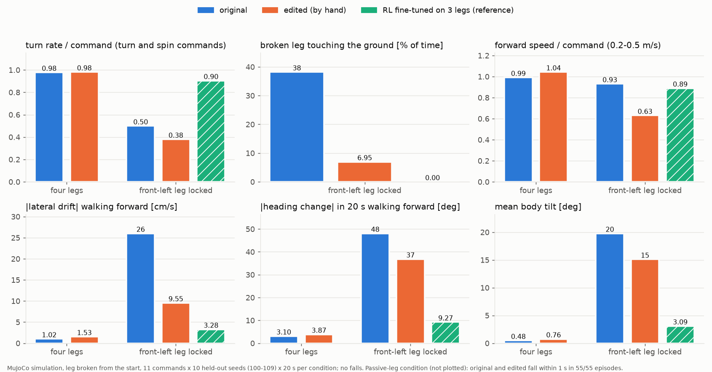
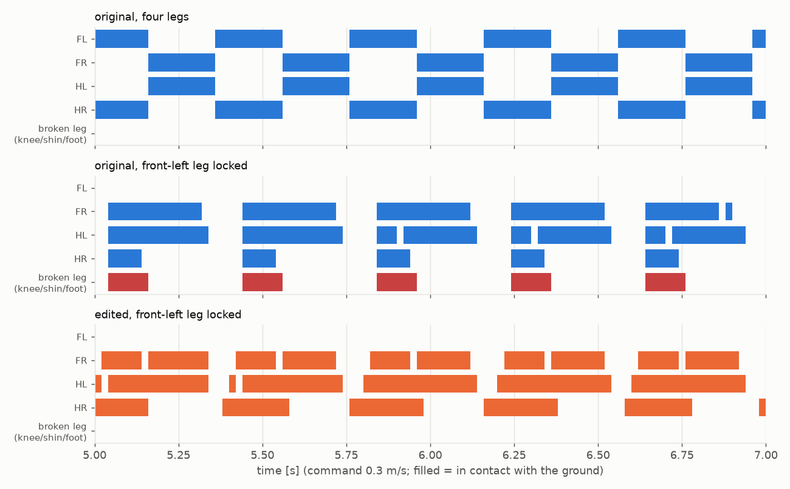
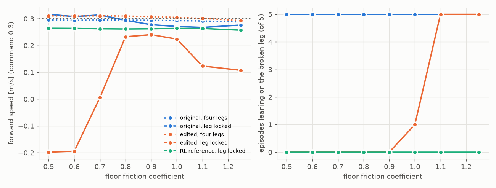

# SOLO-12 on three legs: a walking policy edited by hand, without retraining

A quadruped walking policy (SOLO-12, PPO, MLP 47 → 512 → 256 → 128 → 12, ELU) was trained in MuJoCo on
four legs. Then its front-left leg was broken in simulation (motors off, leg locked folded up), and the
network's weights were edited by hand (by an LLM reading, probing and rewriting them) so that it walks on
the remaining three legs. No gradient descent or RL touched the edited network.

**Short answer, in simulation only:** the edited network does stand and walk on three legs with a level
body, where the original network limps on the folded broken leg (broken leg on the floor 7 % of the time
instead of 38 %, held-out seeds; no falls for either). But it walks slowly (about 0.2 m/s whatever the
command), it does not hold its heading, it turns left poorly, it only works in a narrow band of floor
friction (0.8 – 1.0), and it gets back on three legs in only 10 of 50 cases when the leg breaks *while
walking*. On four legs it still walks like the original. A policy fine-tuned with RL on three legs, kept as a reference, is better on every one of these
measures. The details, including the attempts that failed, are below.



Videos (`results/videos/`, left = original, right = edited, broken leg on the near side):
`three_legs_original_vs_edited_fwd0.3.mp4`, `three_legs_original_vs_edited_stand.mp4`,
`four_legs_original_vs_edited_fwd0.3.mp4`, `leg_locks_while_walking_recovers.mp4`,
`leg_locks_while_walking_fails.mp4`, `three_legs_edited_vs_rl_reference_fwd0.3.mp4`.

---

## 1. Robot and simulator

* **Robot:** SOLO-12 from the Open Dynamic Robot Initiative, taken from `Gepetto/example-robot-data`
  (commit `78b6101`, `robots/solo_description/robots/solo12.urdf` + STL meshes, copied unmodified into
  `assets/solo12/` with the upstream licence; see `assets/solo12/PROVENANCE.txt`). 2.50 kg, 12 joints.
* **MJCF** (`sim/build_model.py`): URDF loaded with MuJoCo's `MjSpec`, then: free base joint, floor;
  primitive collision geoms (foot spheres r = 1.6 cm, shin/thigh capsules, base box) instead of the STL
  collision meshes, no self-collision; joint armature 3·10⁻⁴ kg m², damping 0.01, friction loss 0.01 Nm,
  ranges HAA ±1.0, HFE ±2.6, KFE ±3.0 rad; joint PD as MuJoCo position actuators, **kp = 4 Nm/rad,
  kd = 0.2 Nm s/rad, |τ| ≤ 2.7 Nm**; sensors for feet, knees, base contact and torques. The upstream URDF
  has no usable effort limits (1000), so these values are estimates close to the real robot, not
  identified parameters.
* **Simulator backend:** CPU MuJoCo 4.0.1 with `mujoco.rollout` (16-thread pool, one batched call per
  policy step, 2048 environments, 2 ms physics, policy at 50 Hz), PPO update on the GPU (PyTorch). JAX/MJX
  and MuJoCo Warp were not installed and not tried: the CPU path gave 30–60 k environment steps/s
  (shared CPU), which was enough.

## 2. The original policy (trained)

* **Observation (47, all deployable):** base angular velocity ×0.25, projected gravity, command
  (vx, vy, wz)·(2, 2, 0.25), joint positions − default, joint velocities ×0.05, last action, gait clock
  (sin, cos of 2π·phase, 2.5 Hz; both zero when |command| < 0.1, which means "stand").
  **Action (12):** joint targets `q0 + 0.3·a` (q0 = example-robot-data "standing" pose).
* **Training** (`train/train.py`, `sim/solo_env.py`): PPO (own implementation, rsl_rl-style adaptive
  learning rate), 2048 envs × 24 steps per iteration, asymmetric critic with privileged inputs. Rewards:
  velocity tracking, a trot contact schedule from the clock (FL+HR / FR+HL), swing height, base
  height/attitude, torque, action-rate, foot slip, knee/base collisions, stand-still. Domain
  randomisation: friction 0.5–1.25, base mass −0.2…+0.5 kg, CoM ±1.5 cm, kp/kd ±15 %, torque limit ±10 %,
  pushes of up to 0.4 m/s about every 6 s, observation noise. Commands vx −0.5…0.8, vy ±0.4, wz ±1.
* **Result:** 1200 iterations, 59.0 M steps, **1602 s (27 min) wall time**; final mean episode return
  59.9, fall rate 0, action std 0.12. (The run was started for 3000 iterations and stopped by hand at
  1200 because the return had flattened, see `results/training_curve.png`.) On four legs the exported
  policy tracks 0.2–0.5 m/s at 0.99 of the command, drifts 1 cm/s sideways and turns at 0.98 of the
  commanded rate, with a clean diagonal trot (`results/gait_diagrams.png`, top).
* Exported to `policies/original/policy.onnx` (plain Gemm/Elu graph, sha256 `97c60b95…`), with the
  checkpoint, `config.yaml` and training log.

## 3. The failure

**Primary condition, "locked":** front-left leg, motors produce no torque and the three joints are held
by joint-equality constraints at a tucked pose (HAA 0, HFE 1.6, KFE −2.9 rad: thigh pointing backwards,
shin folded under it, lowest point about 16 cm above the floor when the body is level). The joint
sensors keep reporting the locked angles. Chosen because it is a clean "three legs" situation (the leg
does not touch the ground unless the body tilts toward it) and because a policy that leans on the broken
leg is visible and measurable (`broken_leg_ground_frac` = fraction of time any thigh/shin/foot geom of
that leg touches the floor).

**Secondary condition, "passive":** the same leg with zero torque and free joints. It folds under the
body's weight at once.

Implemented in `harness/sim_harness.py` (`SoloSim(..., fault="locked" | "passive", fault_at=...)`).

## 4. What the original network does on three legs

It does **not fall** (0/110), but it **walks on the broken leg**: in the gait phase where the network
expects support from the front-left foot, only the hind-right foot is on the ground, the body tips onto
the front-left corner and the folded leg slides on the floor 38 % of the time (100 % when standing).
Body tilt 20°, body 6 cm lower, sideways drift 26 cm/s toward the broken side, heading drift 48° in 20 s.
On the passive leg it collapses within 1 s (55/55).



## 5. How the edit was found (in order, including what failed)

Tools allowed: reading weights, probing in simulation, unit freeing, hand-written ELU circuits, linear
solves/readouts (declared when fitted to data), action channels as registers, input/output rewiring.
Every idea was first tried as a **prototype**: a wrapper around the unchanged network that modifies its
inputs and outputs (`analysis/proto_edit.py`), evaluated in the harness. Only the final design was
compiled into the weights. `analysis/attempts.py` re-runs the main attempts on one fixed protocol
(leg locked from the start, 3 seeds, 12 s) → `results/attempts.json`:

| # | attempt | stand: broken leg on floor / tilt | 0.3 m/s: broken leg | vx | tilt | turn left: broken leg | wz (cmd 0.5) | falls |
|---|---|---|---|---|---|---|---|---|
| 0 | original network | 100 % / 24° | 31 % | 0.29 | 20° | 32 % | 0.23 | 0/9 |
| 1 | FR never swings | 100 % / 24° | 100 % | 0.04 | 26° | 100 % | −0.07 | 0/9 |
| 2 | FR short swing | 100 % / 24° | 41 % | 0.38 | 24° | 59 % | 0.27 | 0/9 |
| 3 | 3-beat gait (FR, then HL) | 100 % / 24° | 55 % | 0.22 | 27° | 60 % | 0.27 | 0/9 |
| 4 | posture offset, network sees it | 0 % / 15° | 0 % | −0.01 | 17° | 0 % | −0.02 | 0/9 |
| 5 | posture offset, fixed PD targets, no network | 0 % / 8° | 0 % | 0.00 | 8° | 0 % | −0.00 | 0/9 |
| 6 | posture through an input lie (joint positions) | 100 % / 25° | 30 % | 0.25 | 20° | 32 % | 0.17 | 0/9 |
| 7 | gravity lie | 100 % / 24° | 33 % | 0.28 | 20° | 33 % | 0.19 | 0/9 |
| 8 | posture hidden from the network | 0 % / 15° | 0 % | 0.02 | 15° | 0 % | −0.01 | 0/9 |
| 9 | FR foot under the body (inverted-pendulum design) | 100 % / 26° | 64 % | 0.09 | 38° | 63 % | −0.01 | 0/9 |
| 10 | hidden posture + FR double stance | 0 % / 15° | 0 % | −0.10 | 13° | 0 % | 0.09 | 0/9 |
| 11 | + forward command trim 0.5 m/s | 3 % / 18° | 0 % | 0.19 | 10° | 0 % | 0.13 | 0/9 |
| 12 | + trims (0.7, 0.2, 0.2) + yaw-rate loop K = 0.5 (**final**) | 0 % / 14° | 0 % | 0.24 | 10° | 27 % | 0.14 | 0/9 |
| 13 | ablation: final without hiding the posture | 14 % / 22° | 74 % | 0.05 | 51° | 68 % | −0.02 | 0/9 |
| 14 | ablation: final without the FR re-timing | 0 % / 14° | 5 % | 0.06 | 17° | 4 % | 0.31 | 0/9 |
| 15 | ablation: final without the posture offset | 100 % / 25° | 75 % | 0.08 | 27° | 95 % | 0.01 | 0/9 |
| 16 | final + tilt feedback (rejected) | 0 % / 46° | 0 % | 0.14 | 44° | 0 % | −0.62 | 6/9 |
| 17 | final + get-up reflex (rejected) | 0 % / 81° | 0 % | 0.08 | 80° | 0 % | −0.50 | 9/9 |

The story behind the table:

1. **Measure first.** Contacts binned by gait phase showed the problem precisely: in a trot the
   front-left foot and the hind-right foot share a stance phase. Without the front-left leg, in that
   half-cycle the robot stands on the hind-right foot alone, 26 cm from the centre of mass, and falls
   onto the broken corner every cycle. The network then "uses" the folded leg as a skid.
2. **Change only the timing (rows 1–3).** Keeping the front-right foot down in that phase, shortening its
   swing, or making the front-right and hind-left legs swing one after the other: all still lean on
   the broken leg. Timing alone does not move the centre of mass.
3. **Change the posture (rows 4–5, 8).** Shifting the three working feet forward-left relative to the
   body (body back-right, 6–7 cm) puts the centre of mass inside the triangle of the remaining feet.
   With fixed PD targets (no network, row 5) the robot then stands level on three legs: a static
   three-leg stance exists. Added to the outputs of the network, the offset is seen by the network
   through its *last-action* input and it partly pulls it back; subtracting the offset from the
   joint-position and last-action inputs ("hiding" it, a change of coordinates) is what makes it work
   once the robot walks: in this short protocol rows 4 and 8 look alike while standing, but with the
   final design minus the hiding (row 13) the robot leans on the broken leg 74 % of the time at
   0.3 m/s. An earlier probe that hid only one of the two input parts pointed at the last-action input
   as the one that matters.
4. **Lies instead of output offsets (rows 6, 7).** Telling the network that its legs (or gravity) are
   displaced, so that it moves the legs itself: it keeps limping.
5. **A design from the inverted-pendulum model (row 9)** – front-right foot moved under the body so that
   both support lines (FR–HL and FR–HR) pass near the centre of mass – fell onto the broken corner in
   every run. The network's balance reactions, trained for four legs, do not cooperate with it.
6. **Hidden posture + front-right double stance (row 10).** The front-right leg replays its own stance
   twice per cycle, with two short swings at phases 0.40–0.50 and 0.90–1.00 instead of one long swing.
   The robot now steps on three legs with a level body, but walks backwards or not at all.
7. **Command trim (rows 11–12).** The network on three legs moves much slower than it "thinks": adding
   a constant +0.5…0.7 m/s to the forward command it sees gives about 0.2 m/s. A constant yaw/side trim
   and a proportional yaw-rate loop (`wz seen = wz + 0.5 (wz − gyro_z)`) reduce the right turn the
   asymmetric gait produces. Gains K = 1 and 2 reduced the walking speed and were not kept.
8. **Ablations (rows 13–15):** removing any of the three parts of the final design breaks it: without
   hiding the posture or without the posture offset the robot leans on the broken leg again; without
   the front-right re-timing it stays level but barely moves forward (0.06 m/s).
9. **Rejected later** (rows 16–17, and probes not in the table): a feedback that shifts the feet in
   proportion to the tilt, and threshold "get-up" reflexes (several directions and amplitudes) meant to
   lift the robot off the broken leg after a fault while walking: they either tip the robot over or do
   not change the recovery rate. Constant-folding the whole last-action input (so that output edits
   become invisible to the network) cost 30 % of the forward speed on four legs and was not used.
   Using the nominal front-right pattern of a faster gait (0.5–0.7 m/s) gave up to 0.32 m/s at low
   commands but made the robot lean on the broken leg at 0.5 m/s.

The design parameters (foot shift, swing windows, trims, K) were picked by trying about a hundred
prototype configurations in this same simulator, a few commands and seeds each. That is a search done by
hand in simulation, not gradient descent; it is also why the results are reported on held-out seeds
(section 7).

## 6. The edit as it is written in the weights

Same architecture and dimensions (47 → 512 → 256 → 128 → 12, ELU), same `config.yaml`.
Builder: `edit/build_edit.py` (original ONNX in → edited ONNX out, 6 s, bitwise reproducible);
circuit: `edit/three_leg_circuit.py`; unit freeing: `edit/free_units.py`.

```text
inputs used:  q_FL = joint positions − default of the front-left leg (obs 9-11), dq_FL = its velocities ×0.05 (obs 21-23)
              gyro_z (obs 2), command (obs 6-8), clock s = sin 2πφ, c = cos 2πφ (obs 45, 46)

fault signal  g = w · [q_FL, dq_FL]           w = (−0.647, 0.323, −0.521, 0.296, 0.345, 0.221)
              g = 0.99…1.03 with the leg locked;  on four legs rms 0.068, max 0.30
fault flag    F = clamp((g − 0.55) / 0.30, 0, 1)
gait gate     G = clamp(6 (|s| + |c|) − 5 + 10 (F − 1), 0, 1)        (1 = leg broken AND clock running)

what the original units now receive (first layer):
   wz'      = wz + 0.5 (wz − gyro_z)                                  E1, always on
   q_rel'   = q_rel − 0.3 A · g                                       E2, hides the posture offset
   act'     = last_action − A · g                                     E2
   command' = command + (0.7, 0.2, 0.2) · g   [vx m/s, vy m/s, wz rad/s]      E2, command trim

output:
   a = net(obs') + F · A + G · [0,0,0, D_FR(φ), 0,0,0, 0,0,0]

A     = action offset that moves the feet by (forward, left, down): FR (6, 11, 2) cm, HL and HR (6, 6, 2) cm
        (inverse kinematics of the MJCF legs) = FR (1.578, −1.073, 0.445), HL (0.740, 0.148, −1.761),
        HR (0.877, −0.642, −0.422) in action units (×0.3 rad)
D_FR  = Σ_{i=1..40} C_i · elu(β (s sin φ_i + c cos φ_i − cos α)) + C_0,   φ_i = i/40, β = 108.6, α = 0.236 rad
        least-squares fit (on a fine phase grid) of N_FR(ψ(φ)) − N_FR(φ); rms error 0.011 / 0.029 / 0.036,
        max 0.17 action units (HAA / HFE / KFE)
N_FR  = phase-averaged front-right action of the original policy on four legs at 0.3 m/s
ψ     = phase warp: new swing windows [0.40, 0.50] and [0.90, 1.00] → the original swing [0.50, 0.95];
        each of the two stance gaps → the whole original stance
```

How each piece is realised:

* **E1** rescales first-layer column 8 by 1.5 and subtracts 0.5 × (column 8) from column 2. Exact.
* **E2** is a rank-1 update of the six front-left joint columns: `W0[:, FL] += c wᵀ`, with
  `c = −0.3 W0[:, q] A − W0[:, last_action] A + W0[:, command] trim`. With the leg locked `g ≈ 1` and the
  original units receive exactly the shifted inputs. A first layer cannot multiply, so this is the only
  way found to apply a constant shift only when the leg is broken; the price is that on four legs the
  shift leaks in with `g` (rms 0.068): this is the main reason the edited network is not identical to
  the original on four legs (section 7, row d).
* **Unit freeing:** 46 / 6 / 5 hidden units of the three layers were folded by least squares into the
  other units of their layer (same method as the H1 heading-hold edit; samples from four-leg rollouts of
  the original and three-leg rollouts of the prototype). Action error on held-out samples: rms 0.00097,
  max 0.015.
* **Circuit in the freed units:** layer 1: fault flag (2 units, F = (elu(50 z) − elu(50 (z − 1)))/50),
  |sin| and |cos| (4 units, elu(±2000 x)/2000), 40 bells; layer 2: gate G (2 units), D_FR pass-through
  (3 units, bias +6), F pass-through (1); layer 3: D_FR gated by G (3 units,
  elu(D + 6 − 40 + 40 G)) and its reference (1 unit), F pass-through (1); outputs: FR rows get
  gated D minus reference, the nine working-leg rows get A · F.
* **Changed entries** (`weight_edit.json`): mlp.0.weight 5890, mlp.0.bias 46, mlp.2.weight 131072,
  mlp.2.bias 256, mlp.4.weight 32768, mlp.4.bias 128, mlp.6.weight 1536, mlp.6.bias 12 (the fold
  redistributes freed units' outgoing weights onto all other units, so whole next-layer matrices change
  by small amounts).
* **Checks:** edited network vs the prototype on three-leg observations: max |Δa| 0.057, rms 0.0046;
  ONNX vs numpy 2·10⁻⁶. Source sha256 `97c60b95…`, edited sha256 `d2dfdf06…`
  (`policies/edited/weight_edit.json` lists every unit, parameter and both hashes).

**Fitted to data (declared):** `N_FR` (phase averages of the original's own actions, 3 rollouts),
the fault-signal weights `w` (least-norm on 24 000 four-leg observations under the constraint
`w · x_locked = 1`), the least-squares fold. The bell coefficients are a least-squares fit to the
hand-designed function `D`, not to rollouts. Nothing is fitted to the behaviour of the RL reference.

## 7. Results

Protocol (`harness/evaluate.py`, numpy policy, no training code): 1 s standing, then one command for
20 s; 11 commands (stand; forward 0.2/0.3/0.4/0.5 m/s; turn ±0.5 rad/s at 0.3 m/s; spin ±0.5 rad/s;
sideways ±0.2 m/s); each seed draws floor friction 0.7–1.1, base mass −0.1…+0.2 kg, initial joint
noise and gait phase. A fall = base touching the floor, tilt > 60° or height < 0.10 m. **Main table:
10 held-out seeds (100–109)** that were never used while designing the edit; the design seeds (0–4)
give similar but slightly better numbers for the edit (`results/eval_from_start.json`).

| condition | falls | broken leg on the floor | fwd speed / cmd | lateral drift (fwd) | heading change in 20 s (fwd) | turn rate / cmd | tilt | height | mean \|Δaction\| |
|---|---|---|---|---|---|---|---|---|---|
| (a) original, four legs | 0/110 | – | 0.99 | 1.0 cm/s | 3° | 0.98 | 0.5° | 0.223 m | 0.193 |
| (b) original, front-left locked | 0/110 | 38.2 % | 0.93 | 26.0 cm/s | 48° | 0.50 | 19.8° | 0.160 m | 0.254 |
| **(c) edited, front-left locked** | 0/110 | **7.0 %** | 0.63 | 9.6 cm/s | 37° | 0.38 | 15.1° | 0.217 m | 0.326 |
| (d) edited, four legs | 0/110 | – | 1.04 | 1.5 cm/s | 4° | 0.98 | 0.8° | 0.223 m | 0.197 |
| (e) TRAINED reference, front-left locked | 0/110 | 0.0 % | 0.89 | 3.3 cm/s | 9° | 0.90 | 3.1° | 0.210 m | 0.224 |
| (e′) TRAINED reference, four legs | 0/110 | – | 0.80 | 3.7 cm/s | 13° | 0.86 | 2.6° | 0.224 m | 0.262 |

"(fwd)" = averaged over the four forward commands; speed ratio = measured / commanded forward speed;
|heading change| is the mean absolute value per episode. The TRAINED reference is the original fine-tuned
with PPO for 600 iterations (29.5 M steps, 525 s) with the leg locked and without the trot schedule
reward; it is an upper bound, not part of the edit.

Edited network, front-left locked, per command (held-out seeds):

| command | (vx, vy, wz) | vx | vy | wz | broken leg on floor | episodes without leaning on it |
|---|---|---|---|---|---|---|
| fwd_0.2 | (0.2, 0, 0) | 0.20 | −0.04 | 0.06 | 5 % | 9/10 |
| fwd_0.3 | (0.3, 0, 0) | 0.20 | −0.01 | 0.07 | 10 % | 8/10 |
| fwd_0.4 | (0.4, 0, 0) | 0.20 | −0.01 | 0.09 | 11 % | 8/10 |
| fwd_0.5 | (0.5, 0, 0) | 0.19 | −0.01 | 0.10 | 11 % | 8/10 |
| turn_left | (0.3, 0, 0.5) | 0.13 | 0.10 | 0.11 | 40 % | 2/10 |
| turn_right | (0.3, 0, −0.5) | 0.16 | −0.12 | −0.15 | 0 % | 10/10 |
| spin_left | (0, 0, 0.5) | 0.13 | −0.04 | 0.27 | 0 % | 10/10 |
| spin_right | (0, 0, −0.5) | 0.08 | −0.15 | −0.23 | 0 % | 10/10 |
| side_left | (0, 0.2, 0) | 0.08 | −0.06 | −0.02 | 0 % | 10/10 |
| side_right | (0, −0.2, 0) | 0.14 | −0.12 | 0.04 | 0 % | 10/10 |
| stand | (0, 0, 0) | 0.00 | 0.00 | 0.00 | 0 % | 10/10 |

In the forward commands the episodes that lean on the broken leg are the two seeds with the highest
friction (1.03; see the friction sweep below); turning left leans on it at every friction drawn.

**Other conditions**

* **Leg locks while walking** (`--fault_at 4`, 3 s into the command, 10 seeds × 5 commands,
  `results/eval_fault_while_walking.json`, `results/fault_while_walking.png`): the original never
  gets off the broken leg (0/50); the edited network ends up on three legs in **10/50** cases (fwd 0.3:
  3/10, fwd 0.5: 2/10, turns 2/10 and 3/10, stand 0/10). All 10 recoveries are runs where the leg locks
  early in its swing (gait phase 0.95–0.20, foot unloaded); none where it locks while the foot carries
  weight. When it does not recover, it leans on the broken leg more than the original does (40–48 % vs
  29–33 % of the time). The RL reference recovers 50/50.
* **Pushes** (0.3 m/s kick in a random direction every 4 s, fwd 0.3 and stand, 5 seeds): no falls for
  any policy; broken leg on the floor 66 % (original), 4.8 % (edited), 0 % (reference).
* **Passive leg:** original and edited fall within 1 s in 55/55 episodes; the edit does not address
  this case (its fault flag is built on the locked pose). The RL reference, trained on the locked leg,
  falls in 29/55.
* **Friction sweep** (fwd 0.3, fixed friction, 5 seeds, `results/friction_sweep.png`): the edited gait
  works between 0.8 and 1.0 (0.22–0.24 m/s, no leaning). At 0.5–0.6 it walks **backwards** at
  −0.2 m/s (the swing feet move backwards: a second, reversed gait mode); at 0.7 it stays in place; at
  1.1–1.25 it falls onto the broken leg in 5/5 runs. The original limps at every friction; the
  reference walks at 0.26 m/s at every friction. On four legs the edited network walks normally at
  every friction tested.



Plots: `results/summary_bars.png`, `results/trajectories_fwd0.3.png` (paths of 5 seeds per
condition), `results/gait_diagrams.png`, `results/speed_tracking.png`, `results/fault_while_walking.png`,
`results/friction_sweep.png`, `results/training_curve.png`. Machine-readable: `results/results.json`
(all protocols, per-command aggregates, every episode, the attempts table, edit checks and hashes).

## 8. Limits

* **Simulation only** (MuJoCo, this MJCF with estimated actuator parameters), not tested on a real SOLO.
* The edit works for **one leg (front-left) broken in one way** (locked at the tucked pose): its fault
  signal is a linear function of that leg's joint readings. A different leg or locking pose needs a new
  edit; the passive leg is not handled.
* **Narrow operating range:** friction 0.8–1.0 only; backwards walking below, leaning on the broken leg
  above. The gait has several attractors (three-leg walk, backwards walk, leaning on the broken leg) and
  which one the robot ends in depends on friction, seed and, after a fault while walking, the gait phase
  at the moment of the fault (10/50 recoveries).
* **Command tracking is poor:** forward speed about 0.2 m/s for every forward command (0.2–0.5);
  heading not held (mean 37°, worst 86° in 20 s on the held-out seeds, 126° on the design seeds; there
  is no free register for a heading integrator:
  all 12 action channels are used on four legs); sideways commands are not executed; turning at 38 % of
  the command; turning left (toward the broken side) leans on the broken leg 40 % of the time.
* The constant **command trim** means the network is told to walk faster than requested; in stand mode
  the clock is off and the trim has no visible effect, but for spin and sideways commands the robot
  walks forward at 0.08–0.14 m/s.
* **Four legs:** not bit-identical to the original: the yaw-rate loop is always on and the constant
  shift leaks in through `g`. Measured effect: lateral drift 1.0 → 1.5 cm/s, heading change 3° → 4°,
  speed ratio 0.99 → 1.04, no falls (also with pushes and at every friction).
* What is fitted to data is listed in section 6; the design parameters were found by a manual search in
  the same simulator, which is why held-out seeds are reported.
* Not tested: other terrains, slopes, sensor noise/latency, gyro bias, actuator models beyond PD with a
  torque limit, other leg failures.

## 9. Files

```text
assets/solo12/            upstream URDF + STL meshes (unmodified), LICENSE, PROVENANCE.txt, generated MJCF
sim/build_model.py        URDF -> MJCF (solo12.xml with visuals, solo12_train.xml without)
sim/solo_config.py        constants shared by training (obs layout, scales, gait clock, tucked pose)
sim/solo_env.py           vectorised training environment (mujoco.rollout), rewards, domain randomisation
train/ppo.py, train.py    PPO; train/export_policy.py: checkpoint -> policy.onnx + config.yaml
harness/onnx_mlp.py       ONNX <-> numpy MLP;  harness/sim_harness.py: single-robot simulator + broken legs
harness/evaluate.py       evaluation protocol;  harness/record_video.py: side-by-side MP4
analysis/                 probe_lib.py, leg_kinematics.py, proto_edit.py (prototype of the edit),
                          attempts.py, friction_sweep.py, assemble_results.py, make_plots.py
edit/                     build_edit.py (original ONNX -> edited ONNX), three_leg_circuit.py, free_units.py
policies/original/        policy.onnx, checkpoint.pt, config.yaml, training/ (log.csv, train_config.json)
policies/edited/          policy.onnx, config.yaml, weight_edit.json, edit_data.npz, check_io.npz
policies/trained_3leg_reference/   RL fine-tune on three legs (TRAINED, reference only)
results/                  results.json, eval_*.json, attempts.json, *.png, videos/*.mp4
runs/                     training logs and checkpoints (intermediate checkpoints are git-ignored)
```

## 10. Reproduce

From the repository root (`uv` environment `.venv`, Python 3.12, MuJoCo 4.0.1, torch with CUDA):

```bash
cd experiments/solo_three_legs
PY=../../.venv/bin/python

$PY sim/build_model.py                                             # MJCF from the URDF
$PY train/train.py --out runs/solo_walk --iters 1200               # ~27 min on 16 cores + GPU
$PY train/export_policy.py runs/solo_walk/model_final.pt policies/original

$PY edit/build_edit.py policies/original policies/edited          # the hand edit, ~10 s

# optional TRAINED reference (not part of the edit)
$PY train/train.py --out runs/solo_3leg_finetune --fault locked FL --resume runs/solo_walk/model_1200.pt --iters 600
$PY train/export_policy.py runs/solo_3leg_finetune/model_final.pt policies/trained_3leg_reference

P="--policy original=policies/original --policy edited=policies/edited --policy trained_3leg_reference=policies/trained_3leg_reference"
$PY harness/evaluate.py $P --faults none locked passive --seeds 5 --T 20 --out results/eval_from_start.json
$PY harness/evaluate.py $P --faults none locked --seeds 10 --seed_offset 100 --T 20 --out results/eval_heldout_seeds.json
$PY harness/evaluate.py $P --faults locked --fault_at 4.0 --commands stand fwd_0.3 fwd_0.5 turn_left turn_right --seeds 10 --T 20 --out results/eval_fault_while_walking.json
$PY harness/evaluate.py $P --faults locked none --push 0.3 --commands fwd_0.3 stand --seeds 5 --T 20 --out results/eval_pushes.json
$PY analysis/friction_sweep.py
$PY analysis/attempts.py
$PY analysis/assemble_results.py
MUJOCO_GL=egl $PY analysis/make_plots.py
MUJOCO_GL=egl $PY harness/record_video.py --panel "original=policies/original:locked" \
    --panel "edited=policies/edited:locked" --cmd 0.3 0 0 --T 12 --out results/videos/three_legs.mp4
```

Retraining gives a different network (PPO is not bitwise reproducible), and the edit's design
parameters were chosen for this one; `build_edit.py` will run on a new network, but the numbers above
apply to `policies/original` (sha256 `97c60b95…`). The edit itself is bitwise reproducible from that
file (`policies/edited/policy.onnx`, sha256 `d2dfdf06…`).
